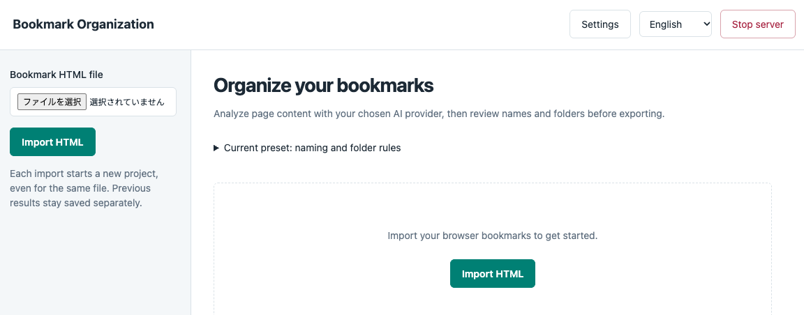
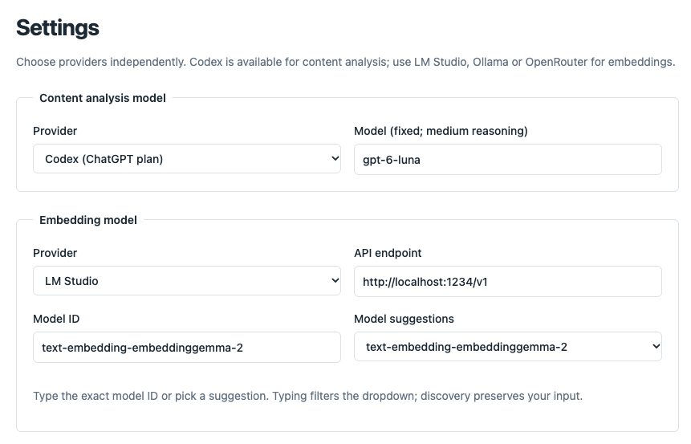
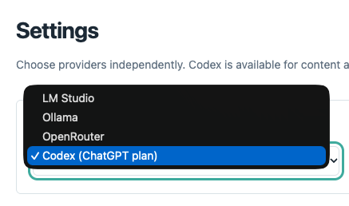

<table>
  <thead>
    <tr>
      <th style="text-align:center"><a href="README_ja.md">日本語</a></th>
      <th style="text-align:center"><a href="README.md">English</a></th>
    </tr>
  </thead>
</table>

# Bookmark Organization

Chromeからエクスポートしたブックマークを、AIで分かりやすい名前と使いやすいフォルダーに整理します。Bookmark OrganizationはローカルWebアプリです。HTMLを読み込み、整理する範囲を選び、提案を確認してから、Chrome用のHTMLを書き出せます。

コンテンツ分析には**LM Studio**または**Ollama**のローカルモデル、**OpenRouter**のクラウドモデル、または**ChatGPTログイン**を使う**Codex**を利用できます。分析と埋め込みのプロバイダーは個別に設定します。



*ブラウザーのブックマークファイルを読み込んでプロジェクトを開始します。*

## できること

- すべてのブックマーク、1つのフォルダー、または複数のフォルダーをまとめて整理できます。
- 各ページを個別に読み込み、名前と作業内容に合った保存先を提案します。埋め込みは、選択済みのフォルダー内で関連するブックマークを並べるために使います。
- 名前付けとフォルダー分けの指示を別々に設定でき、生成する名前の言語も指定できます。
- 元の名前・場所と提案を比較できます。検索、状態による絞り込み、提案の編集にも対応しています。
- 進捗と提案の変更履歴が保存されるため、一時停止して再開したり、後から別のフォルダーを整理したりできます。
- 英語と日本語のインターフェースを利用できます。ブラウザーの言語も自動判定します。

元のHTMLはいつでもダウンロードでき、バイト単位で保持されます。同じURLのブックマークも別々に保持し、ページ取得に失敗しても項目は削除しません。生成されるエクスポートはすべて、ブックマークの識別情報、件数、URLごとの重複数、選択範囲外の内容が保たれていることを検証します。

## 必要なもの

- **Python 3.13** と **uv**。
- フロントエンドのビルド用に **Node.js 26.5以降** と **npm 12.0.1以降**。
- 下表から選ぶ分析プロバイダーと埋め込みプロバイダー。ローカルモデルを使う場合は、モデルをランタイムにインストールして利用可能にしておきます。
- Codexで分析する場合は、サーバーの `PATH` で使える **Codex CLI** と **ChatGPTログイン**。

開発と検証はApple silicon搭載macOSで行っています。コンソールからの起動ではUnixファイルロックを使うため、Windowsでのサポートは確認されていません。このアプリはモデルをダウンロードせず、Chromeプロフィールを直接編集しません。

## クイックスタート

リポジトリのディレクトリで次を実行します。

```sh
uv sync --locked
npm ci
npm run build
uv run --locked bookmark-organization
```

ターミナルに表示されたURL（通常は[http://127.0.0.1:8765](http://127.0.0.1:8765)）を開きます。ポートを指定しない場合、起動時に **8765–8769** を順番に試します。同じデータディレクトリですでにサーバーが起動している場合は、ワーカーを追加せず既存サーバーのURLを表示します。

分析を始める前に **Settings（設定）** を開き、分析と埋め込みの両方のモデルを設定して保存します。フロントエンドのファイルはローカルから配信されます。ソースを変更した後は `npm run build` で再ビルドしてください。

ヘッダーの **Stop server（サーバーを停止）** またはターミナルの **Ctrl+C** でアプリを停止します。中断したジョブは保存済みの進捗を保持して一時停止状態で再開できます。続けるには起動コマンドをもう一度実行してください。データディレクトリごとにサーバーとワーカーを1つずつ実行してください。アプリの起動中に `server.lock` を削除しないでください。

## モデルの設定



*例：Codexでページを分析し、埋め込みにはLM Studioのローカルモデルを使います。*

| プロバイダー | コンテンツ分析 | 埋め込み | 接続先 |
| --- | --- | --- | --- |
| LM Studio | 対応 | 対応 | ローカルサーバー。通常は `http://localhost:1234/v1` |
| Ollama | 対応 | 対応 | ローカルサーバー。通常は `http://localhost:11434/v1` |
| OpenRouter | 対応 | 対応 | 固定URL `https://openrouter.ai/api/v1`。APIキーが必要 |
| Codex（ChatGPT plan） | 対応 | 非対応 | ChatGPTログイン済みのCodex CLI |

LM Studio、Ollama、OpenRouterを使う場合：

1. 分析と埋め込みそれぞれのプロバイダーを選びます。ローカルランタイムを使う場合はAPIサーバーを起動します。
2. OpenRouterを使う場合は、モデルの一覧取得や保存の前にSettings（設定）へAPIキーを入力します。
3. **Discover models / test connection（モデルを検出／接続を確認）** をクリックし、候補から選ぶか、モデルIDを正確に入力します。
4. **Save（保存）** をクリックします。一覧の更新では候補だけが更新され、入力済みのモデルIDは置き換わりません。一覧取得では推論を実行しません。

LM Studioの初期モデルIDは、分析が `qwen3.5-9b-uncensored-hauhaucs-aggressive`、埋め込みが `text-embedding-embeddinggemma-2` です。実際にはランタイムが公開するIDを使ってください。IDはファイル名と異なる場合があり、プロバイダー間でも異なることがあります。モデルのインストールと読み込みはランタイム側で行います。

ローカルの接続先にはループバックアドレスを指定してください。LM StudioとOllamaのクラウドモデルは一覧から除外され、ローカルで失敗してもクラウドプロバイダーへ自動で切り替わりません。

### ChatGPTプランでCodexを使う

アプリをホストするマシンで `codex login` を実行し、ChatGPTログインを選びます。コンテンツ分析に **Codex (ChatGPT plan)** を選択して保存します。埋め込みはLM Studio、Ollama、OpenRouterから別途設定してください。



Codexは **`gpt-6-luna`** モデルと **medium** 推論を固定で使用します。APIキーによるログインは拒否されます。各ページには独立した一時CLIセッションを使い、分析指示を分離してツールを無効化します。JSON応答はアプリ側で検証します。アプリのサンプリング設定と出力トークン数はCodexには適用されませんが、モデル応答の待機時間設定は適用されます。

CLIの検出ではログイン状態とモデルカタログを確認します。実際にモデルを利用できることは、分析に成功して初めて確認できます。記録済みの検証ではCodex CLI **0.162.1**を使い、`gpt-6-luna`/mediumで独立した分析を2回実施しています。この結果は、すべてのCLIバージョンとの互換性を保証するものではありません。

### 推論の設定

初期設定の **Use web app settings（ウェブアプリの設定を使う）** では、思考をオフにします。この設定は、対応する思考、温度、サンプリングの項目を適用します。対応するサンプリング項目のチェックを外すと、無効化を示す中立値を送ります。**Use runtime settings（ランタイムの設定を使う）** を選ぶと、これらの上書きは行わず、ランタイムのAPIデフォルトに任せます。どちらを選んでも、保存済みのランタイム設定は変更されません。

**Model response wait（モデル応答の待機時間）** の初期値は **0＝無制限** です。正の秒数を指定すると待ち時間を制限できます。一時停止は処理中のリクエストが返るまで待ちます。キャンセルするとアプリ側のリクエスト待機を中断し、ジョブを終了状態にします。外部プロバイダーは、すでに受け付けた処理を続ける場合があります。

新しいジョブには、その時点のモデル設定と名前・フォルダーのルールが保存されます。Settings（設定）を変更しても、既存ジョブに保存されたプロバイダーとモデルの選択は変わりません。

## 整理とエクスポート

1. **Import（読み込み）**。ChromeのブックマークをUTF-8 HTMLとしてエクスポートし、ファイルをアップロードします。内容やファイル名が同じでも、アップロードごとに新しいプロジェクトを作成します。以前のプロジェクトと結果は別々に保存されます。
2. **Select（選択）**。すべてのブックマーク、または1つ以上のフォルダーを選びます。配下のブックマークも含まれ、重複する選択によって同じ項目を二重に処理することはありません。フォルダーを選んだ場合は、選択したフォルダーのうち、ほかの選択フォルダーの内側にないフォルダーを保存先にします。すべてのブックマークを選ぶと、`整理済み`という名前のルートフォルダーを作成します。
3. **Set rules and analyze（ルール設定と分析）**。**Rules for this analysis（今回の分析ルール）** で、名前とフォルダーごとにPreset（プリセット）またはCustom instructions（カスタム指示）を選びます。カスタム欄が空なら該当するプリセットを使います。ブラウザーのタブを閉じても処理は続きます。
4. **Review failures（失敗を確認）**。取得に失敗した項目は元の名前のまま `404` や `アクセス制限` などのフォルダーに残ります。原因を解消し、必要に応じて **Retry failed（失敗分を再試行）** を使います。分析失敗を提案に含めるには、`要確認`への配置を明示的に許可する必要があります。
5. **Review and save a proposal（提案を確認して保存）**。名前と場所を比較し、編集して保存します。保存のたびに提案の新しい版を作成し、元のインポートは保持します。
6. **Continue if needed（必要に応じて続行）**。**Organize another folder（別のフォルダーを整理）** を使うと、直近の保存結果から新しい指示で続けられます。未選択のブックマークは保存済みの名前と場所を保ちます。提案を保存した後に対象項目を再処理する場合は、そのジョブを再試行せず、新しい分析を開始します。
7. **Export（エクスポート）**。整合性検証に合格した後、**All bookmarks（すべてのブックマーク）** または **Changed blocks only（変更したブロックのみ）** をダウンロードできます。変更していない元ファイルもダウンロードできます。

**Changed blocks only（変更したブロックのみ）** には、これまでの整理で対象になったブックマーク（取得・分析失敗を含む）と、現在の親フォルダーから上位までのフォルダーが含まれます。未処理の兄弟項目や無関係な空フォルダーは含みません。どちらの範囲をエクスポートする場合も、提案全体の整合性検証が必要です。

最初は小さな範囲で試し、Chromeにインポートする前に結果を確認してください。Chromeへのインポートでは既存のコレクションにブックマークが追加されます。エクスポートを確認するには、別のプロフィールを使うと便利です。クラスタリングの距離計算に必要なメモリの推定予算128 MiBを超える選択範囲は、複数の小さなフォルダー群に分けてください。

**Pause / Resume（一時停止／再開）** は、後から続けられるようにジョブを保持します。**Cancel（キャンセル）** は実行中または一時停止中のジョブを終了させますが、インポート、設定のスナップショット、保存済み結果は保持します。キャンセル済みのジョブは再開、再試行、提案の作成ができません。新しい分析を開始してください。

### 名前とフォルダーの初期ルール

プリセットでは、日本語の名前を **`具体的な用途｜固有名`** の形式で生成します。例：

| ページ | 名前の例 |
| --- | --- |
| 翻訳サービス | `文章を翻訳｜DeepL` |
| GitHub CLIツール | `動画をダウンロード｜yt-dlp［CLI］` |
| 特定のドキュメントページ | `正規表現の書き方を確認｜Python re` |

フォルダーはブックマークを開く目的ごとにまとめます。同じ作業に使うリポジトリ、公式サイト、記事を集約します。保存先の下に生成するフォルダーは最大 **2階層** です。プリセットでは、親フォルダー内のほかの目的と区別できる下位分類があり、該当ブックマークが3件以上ある場合にだけ専用フォルダーを作ります。用途が不確かな項目は、後で確認できるよう `あとで整理` に入れます。

カスタム指示では片方のルールだけを置き換えることもできます。たとえば、名前を英語にしつつフォルダーはプリセットのままにしたり、`JS libraries`、`Python`、`Utilities` に分類したりできます。明示的に指定したカスタムサブフォルダーは、少数の項目でも最大2階層の範囲内で保持します。画面の表示言語を変えても生成ルールは変わらず、保存済みの名前も翻訳されません。

## データとプライバシー

アプリの画面はループバック上で提供され、作業データはローカルに保存されます。初期設定の **`data/`** ディレクトリには、SQLiteデータベース、元のインポート、取得したコンテンツと結果、提案の変更履歴、設定、保存済みのOpenRouter認証情報が含まれます。バックアップ前にサーバーを停止してください。

- **LM Studio / Ollama：** 推論はローカルで行います。ページ取得ではブックマーク先のWebサイトに接続します。
- **OpenRouter：** 分析ではURL、元の名前とフォルダー、上限内のページ本文など、選択した入力を送信します。クラウド埋め込みにはタイトルと分析テキストを送信します。料金やデータの取り扱いは選択したプロバイダーによって異なります。
- **Codex：** 選択した分析入力をOpenAIに送信し、ChatGPT/Codexプランの利用枠を消費します。

Settings（設定）に入力したOpenRouterキーは `credentials.json` に分けて保存され、所有者のみが読み書きできる権限（`0600`）になります。設定スナップショット、API応答、表示されるHTMLには含まれず、ローカルランタイムにも転送されません。キー欄を空にして保存すると、保存済みキーを維持します。キーが保存されていない場合は `OPENROUTER_API_KEY` を代わりに使います。

初期設定のデータディレクトリはGitの管理対象外です。独自のデータディレクトリも除外し、元のブックマーク、取得した非公開コンテンツ、認証情報、モデルバイナリをGit管理下に置かないでください。

### ランタイム設定

| 環境変数 | 初期値／動作 |
| --- | --- |
| `BOOKMARK_DATA_DIR` | 作業ディレクトリからの相対パス `data/` |
| `BOOKMARK_PORT` | 未指定：`8765–8769` で最初に利用可能なポート |
| `OPENROUTER_API_KEY` | 任意のサーバー側フォールバックキー |

```sh
BOOKMARK_DATA_DIR=./my-bookmark-data BOOKMARK_PORT=8766 uv run --locked bookmark-organization
```

ポートを指定した場合はそのポートだけを使い、使用中なら起動に失敗します。`BOOKMARK_PORT=0` を指定するとOSがポートを選びます。表示されたURLを開いてください。

### ページ取得と任意の描画

ページ取得ではプライベートおよび予約済みのネットワーク宛先をブロックし、リダイレクトごとに接続先を検証します。ブラウザーのサブリソースと手動再試行を含め、ワーカー全体でリクエスト開始間隔を少なくとも **0.5秒** 空けます。失敗は自動再試行せず、`robots.txt` も確認しません。未対応のURLスキームは取得せず、コレクション内に保持します。

JavaScriptの描画が必要なページでは、ChromiumをインストールしてSettings（設定）で描画を有効にします。

```sh
uv run --locked playwright install chromium
```

描画時も同じネットワーク制限が適用されます。ログイン要件やCAPTCHAを回避することはできません。

## 開発と検証

アプリは **FastAPI、Jinja2、HTMX、TypeScript、SQLite** を使います。

| パス | 内容 |
| --- | --- |
| [`src/bookmark_organization/`](src/bookmark_organization/) | アプリ、モデルアダプター、永続化、テンプレート |
| [`frontend/`](frontend/) | フロントエンドのソース。`npm run build` でビルド |
| [`tests/`](tests/) | 単体テスト、ブラウザーワークフロー、実モデルの検証 |
| [`docs/design/README.md`](docs/design/README.md) | インターフェース仕様 |
| [`NOTES.md`](NOTES.md) | 実装上の理由と検証の限界 |
| [`PLANS.md`](PLANS.md) | 設計、受け入れ条件、過去の進捗 |

`src/bookmark_organization/static/` 内の生成ファイルはGitの管理対象外です。リポジトリのディレクトリから次のチェックを実行します。

```sh
uv run --locked ruff check src tests
uv run --locked ruff format --check src tests
uv run --locked ty check src
uv run --locked pytest -q
npm run lint
npm run typecheck
npm run build
uv run --locked python tests/smoke_app.py
```

ブラウザースモークテストには、ビルド済みアセットとPlaywright Chromiumが必要です。実際のアプリサーバーを起動し、推論にはテスト用の模擬処理を使います。デスクトップとモバイルの画面幅で英語・日本語のワークフローを確認します。合成テストは実モデルとの互換性を証明しません。

実モデルの検証では、公開テキストのフィクスチャを2件使います。実際のページは取得せず、保存済みのアプリ設定も変更しません。

```sh
# 固定Codexモデルでの分析のみ。埋め込みとエクスポートは行いません。
uv run --locked python tests/smoke_local_models.py --settings data/settings.json --codex

# 選択したプロバイダーと埋め込みを使うカスタムルール、および整合性検証付きエクスポート。
uv run --locked python tests/smoke_local_models.py --settings data/settings.json --custom
```

カスタム検証で生成のみを確認する場合は `--analysis-only` を追加します。どちらのモードも指定しない通常のハーネスでは、LM Studio、`lms` CLI、記録済みGGUFモデルの `Qwen3.5-9B-Uncensored-HauhauCS-Aggressive-Q6_K.gguf` と `embeddinggemma-2-Q8_0.gguf` が必要です。Settings（設定）に対応するAPI IDを指定してください。記録済みの実モデル検証の範囲と限界は [NOTES.md](NOTES.md) を参照してください。
